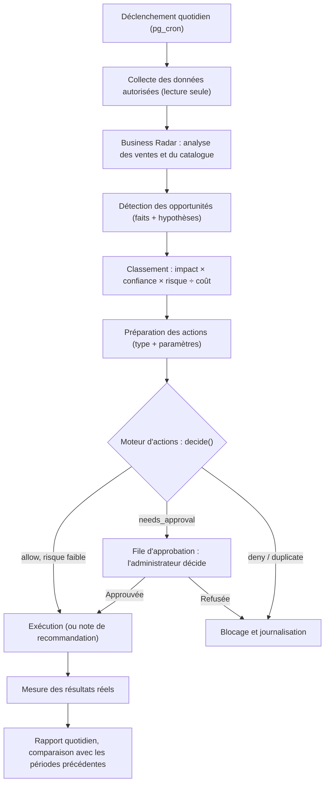

# Zara King Intelligence 360 — audit et plan d'implémentation

Extension de Zara King vers le pilotage commercial, le marketing, la fidélisation et l'analyse. **Rien n'est recréé ni remplacé** : le chatbot, le catalogue, les commandes directes, la fidélité, Brevo et Zara Marketing restent tels quels.

> Règle du projet : une fonction n'est déclarée « opérationnelle » que si elle est écrite **et** vérifiée. Ce document sépare donc ce qui est **fait et vérifié**, ce qui est **écrit mais pas encore branché**, et ce qui est **à faire**.

## 1. État d'avancement

| Étape | Contenu | État |
| --- | --- | --- |
| 0 | Audit (phase 1) et plan | **Fait** (ce document) |
| 1 | Moteur d'actions et permissions (phase 6, noyau) | **Écrit et vérifié** : `zara-intel/actions.ts`, 89 vérifications. Pas encore branché à la base ni à l'écran |
| 2 | Business Radar (phase 3) | **Écrit et vérifié** : `zara-intel/radar.ts`, 75 vérifications. Pas encore alimenté par la vraie base |
| 3 | Orchestrateur, fonction serveur `zara-intel`, SQL (réglages, journal, constats, approbations, arrêt d'urgence), collecte des chiffres, passage quotidien | À faire |
| 4 | Fidélité (phase 5) : segments par palier, clients moins actifs, vérification du vrai statut | À faire |
| 5 | Tableau de bord Zara 360 (phase 7) | À faire |
| 6 | Mémoire et mesure des résultats (phase 8), durées de conservation | À faire |
| 7 | Tests d'intégration, essai de bout en bout, déploiement progressif (phase 9) | À faire |

Phase 4 (marketing et Brevo) : le moteur existe déjà (Zara Marketing Intelligence, 10 segments, 3 variantes d'objet, apprentissage, verrou). Il est **écrit et testé mais pas encore en production** (la fonction déployée est l'ancienne version, la base n'a pas le script SQL). L'étape 3 ne fait que l'appeler en simulation.

## 2. Audit : ce qui existe déjà (à réutiliser)

| Domaine | Ce qui existe | Où |
| --- | --- | --- |
| Chatbot Zara | Cerveau côté téléphone (intentions, recherche dans le catalogue, textes français/arabe, vente, commande dans le chat, fidélité, rappel WhatsApp, installation, suggestions discrètes) | `src/store/assistantStore.ts` (3 226 lignes), `assistantBrain.ts`, `assistantText.ts`, `assistantSales.ts`, `assistantMarketing.ts`, `assistantInterest.ts`, `Assistant.tsx`, `AssistantPanel.tsx` |
| Zara IA | Fonction serveur qui répond aux messages libres, **en lecture seule** (outils : chercher des articles, lister les promotions), limite de 20 messages par visiteur et par jour | `supabase/functions/zara-ai` |
| Assistant marketing | Rédige des publicités pour l'administrateur (jeton administrateur exigé) | `supabase/functions/marketing-ai` |
| Catalogue, commandes, clients | Tables `products` (402 actifs), `categories` (17), `orders`, `profiles` (514), `favorites`, `reviews` ; commande directe (plus de panier) | `supabase/schema.sql`, `src/lib/orders.ts` |
| Fidélité | 1 point par tranche de 5 000 FCFA livrée (déclencheur `award_loyalty_points`), paliers Bronze 0 / Argent 25 / Or 50 / Platine 75 / Diamond 100 ; remise −10 % sur les articles à la 7ᵉ commande (6 livrées), une seule fois | `src/lib/loyalty.ts`, `loyaltyDiscount.ts`, `add-loyalty-points.sql`, `add-loyalty-discount.sql` |
| Brevo | Fonction `brevo-email` : e-mails de commande, bienvenue, publicité « absents », désinscription en un geste ; clé dans les Secrets de la fonction ; **Zara Marketing Intelligence** (branche de travail) | `supabase/functions/brevo-email` |
| Événements de navigation et de conversion | `visitor_sessions` (visites, source, UTM), `product_views`, `cart_events` (bouton « Commander » : intentions), `visitor_product_interest`, `browsing_searches`, `assistant_events`, `assistant_chats`, `app_installs`, `app_download_clicks`, `orders.session_id` (attribution), clics des notifications | tables du même nom |
| Base et tâches planifiées | 38 tables, **RLS partout**. 4 tâches (`pg_cron`) : notifications programmées (chaque minute), file des e-mails (chaque minute), publicité « absents » (8 h), rapport hebdomadaire Telegram (lundi 8 h) | `*.sql` à la racine |
| Fonctions serveur | 8 : `telegram-webhook`, `telegram-broadcast`, `send-broadcast-push`, `send-product-push`, `send-web-push`, `zara-ai`, `marketing-ai`, `brevo-email` | `supabase/functions` |
| Tableaux de bord admin | Tableau de bord (ventes du jour, articles les plus vus, stock bas, performance par source), Statistiques de Zara, Suivi de navigation, Meilleurs clients potentiels, Performance par source, Zara Marketing | `src/screens/admin`, `src/constants/adminMenu.ts` |
| Authentification et autorisation | `profiles.is_admin` + fonction SQL `is_admin()` ; les fonctions d'administration refont la vérification ; fonctions serveur : jeton d'administrateur **ou** secret partagé (`x-cron-secret`, coffre-fort) ; clés dans les Secrets ; règle « grant explicite » pour toute nouvelle table | `supabase/schema.sql`, `brevo-email/index.ts` |
| Tests | 14 fichiers e-mails, cerveau de Zara (300+), interface complète (~1 000 vérifications, dernier essai complet : **997 OK, 0 échec**) | `tests/` |

## 3. Audit : faits observés (lecture seule, 25 octobre 2026)

Ce sont des **faits** lus dans la base, sans interprétation.

- **514 comptes**, dont 498 avec l'accord « promotions » ; 402 articles actifs, aucun en rupture.
- **0 commande** dans la table `orders`, depuis le début (le site existe depuis août 2026).
- Visites : 11 829 sur 30 jours contre 12 408 sur les 30 jours d'avant (−4,7 %, sous le seuil de 15 % du radar : rien à signaler).
- Consultations d'articles : 7 103 sur 30 jours. Intentions de commander (`cart_events`) : 351 sur 30 jours, la dernière aujourd'hui.
- Recherches enregistrées : 105 depuis le 18 octobre 2026, **avec le mot seulement** (pas le nombre de résultats).
- Zara : 51 conversations ouvertes, 12 événements (uniquement des questions d'installation).
- E-mails : 58 lignes dans la file (commandes, bienvenue, publicité « absents »), aucune de campagne.

## 4. Audit : points d'attention (avant de construire)

1. **Aucune commande enregistrée.** Sans commandes, ni le taux de conversion, ni les commandes attribuées aux campagnes, ni la fidélité par palier ne peuvent être mesurés. **Hypothèse (à confirmer par l'administrateur)** : les commandes passent par WhatsApp ou par téléphone, hors du site (un bouton « Commander sur WhatsApp » existe). Le radar le dit explicitement (`dq:no_orders`) au lieu d'afficher un taux. Les « intentions de commander » servent d'indicateur de remplacement, étiqueté comme tel.
2. **Les recherches sans résultat ne sont pas enregistrées.** Le site n'envoie que le mot. Le radar les **estime** avec une règle simplifiée (un mot en commun avec un nom d'article actif ou de catégorie) et le dit. Une mesure exacte demanderait d'envoyer aussi le nombre de résultats depuis le site : modification du site public, **non faite**, à décider.
3. **Le nom « panier » reste dans la base** (`cart_events`, `AdminAbandonedCarts`). La table enregistre toujours les touches sur « Commander » ; l'écran « paniers abandonnés » est une page ancienne hors menu. Rien n'est recréé ; le radar utilise `cart_events` comme « intentions de commander ». Nettoyage éventuel : hors périmètre.
4. **Zara Marketing n'est pas encore en production** : branche non fusionnée, fonction déployée = ancienne version, script SQL non lancé. Il attend la décision « Oui » de l'administrateur.
5. **Consentement** : l'accord est celui des réglages du profil (`notify_*`) ; la case est pré-cochée à l'inscription et parle de « notifications ». Point déjà signalé : à décider avant tout envoi réel.
6. **Aucune IA générative n'est nécessaire** pour le radar, l'orchestrateur et le moteur d'actions : ce sont des règles fixes, testables. Une IA pourra plus tard **rédiger** des textes (résumés, e-mails), jamais décider, ni accorder une permission, ni modifier le code.

## 5. Ce qui manque réellement (et rien d'autre)

| Phase | Déjà là | À créer |
| --- | --- | --- |
| 2 Orchestrateur | Tâches planifiées dispersées, rien de central | Module qui collecte, analyse, classe, passe chaque action par le moteur d'actions, journalise |
| 3 Radar | Rapport hebdomadaire Telegram (3 articles, 3 mots), chiffres du tableau de bord | Détecteurs avec seuils, comparaison de périodes, faits séparés des hypothèses, priorités — **fait (étape 2)** |
| 4 Marketing / Brevo | Moteur complet (branche) | Seulement l'appeler en simulation et afficher son résultat |
| 5 Fidélité | Règles de points, paliers et −10 % ; segment « 4 livrées ou plus » | Segments par palier, clients moins actifs, vérification du vrai statut avant tout message |
| 6 Actions et permissions | Verrou propre à Zara Marketing | Registre d'actions, permissions indépendantes du modèle, approbations, idempotence, arrêt d'urgence — **fait (étape 1)** |
| 7 Tableau de bord | Pages dispersées | Une page « Zara 360 » |
| 8 Mémoire | File d'e-mails, apprentissage marketing, purge à 90 jours du suivi | Tables `intel_*`, mesure des actions, durées de conservation |
| 9 Tests et déploiement | Tests e-mails, cerveau, interface | Tests des nouveaux modules, essai complet, déploiement progressif |

## 6. Architecture cible



Un seul module modulaire (`supabase/functions/zara-intel/`), pas plusieurs agents autonomes :

| Fichier | Rôle | État |
| --- | --- | --- |
| `actions.ts` | Registre des actions, risques, permissions, limites, idempotence, approbations, arrêt d'urgence | fait |
| `radar.ts` | Détecteurs et classement | fait |
| `orchestrator.ts` | Enchaîne collecte → radar → actions → exécution → mesure | à faire |
| `loyalty.ts` | Segments et vérifications de fidélité | à faire |
| `index.ts` | Fonction serveur : même méthode de contrôle que `brevo-email` (jeton d'administrateur ou secret partagé) | à faire |

## 7. Le moteur d'actions (étape 1, vérifié)

Chaque action déclare : type, paramètres (schéma **strict** : un champ inconnu est refusé), niveau de risque, permission requise, limites (par passage et par 24 h), règle d'approbation, exécuteur, identifiant unique.

| Famille | Exemples | Décision |
| --- | --- | --- |
| Analyses, rapports, préparation (risque nul ou faible) | analyser, résumé quotidien, prévenir l'administrateur, **préparer** la campagne en simulation, préparer un message de fidélité, recommandations (réapprovisionner, ajouter un article, revoir une catégorie) | **Automatique**, dans les limites et si la permission est accordée |
| Marketing et fidélité qui touchent des clients | lancer l'envoi d'une campagne, envoyer un message de fidélité | **Approbation**, sauf si l'administrateur a **pré-approuvé** ce type (dans ses limites). Le verrou de Zara Marketing s'applique en plus |
| Opérations sensibles | modifier un prix, remise exceptionnelle, remboursement, budget publicitaire, règles de fidélité | **Approbation explicite à chaque fois**, non pré-approuvable, **jamais exécutées par le système** (recommandation pour l'administrateur) |
| Interdit | modifier les permissions, le code de production, les règles de sécurité, les paramètres financiers ; contacter une personne désabonnée ; exporter des données personnelles | **Refusé toujours**, même recommandé par l'IA, même demandé par ce canal |

Garanties vérifiées par les tests : la décision ne dépend **pas** de la source (IA, règle ou administrateur : même verdict) ; elle ne modifie rien (entrées gelées) ; l'IA ne peut ni approuver sa propre action, ni accorder une permission, ni élargir ses droits par les paramètres ; une approbation ne vaut que pour **ces** paramètres, expire au bout de 24 h et ne contourne ni les limites, ni les doublons, ni l'arrêt d'urgence ; l'administrateur peut **baisser** une limite, jamais la relever ; les réglages illisibles donnent « éteint » et « arrêt d'urgence actif » (par défaut, tout est arrêté) ; les actions simulées ne consomment jamais le budget des vraies.

## 8. Le Business Radar (étape 2, vérifié)

Détecte : variations de visites, consultations, intentions, commandes et recherches (seuil 15 %, avec une base minimale) ; recherches sans résultat (estimation) ; catégories très regardées mais peu transformées ; articles populaires et en hausse ; risques de rupture et demande sur des articles indisponibles ; occasion de campagne ; qualité des données (aucune commande).

Règles : un **fait** a toujours sa source ; une **hypothèse** commence toujours par « Hypothèse : » ; `causeEstablished` est toujours faux (une baisse n'est jamais expliquée sans preuve : « aucune cause n'est établie… pistes à vérifier ») ; la **confiance** dépend de la taille de l'échantillon ; l'**impact** est un score de 0 à 100 expliqué, pas un montant ; **priorité = impact × confiance × facteur de risque ÷ facteur de coût** ; le radar ne propose **que** des actions faibles : jamais d'envoi, de prix, de remise ni de remboursement ; chaque proposition passe le schéma strict du moteur d'actions (testé).

## 9. Prochaines étapes, migrations et déploiement

Étape 3 (prochaine). Tables prévues, toutes avec RLS et **grants explicites** (règle du projet), lecture réservée à l'administrateur, écriture par la fonction serveur seulement :

| Table | Rôle | Conservation prévue |
| --- | --- | --- |
| `intel_settings` | Une ligne : mode (éteint / simulation / réel), **arrêt d'urgence (actif par défaut)**, permissions accordées, types pré-approuvés, limites abaissées | permanent |
| `intel_runs` | Un passage par jour : durée, erreurs | 180 jours |
| `intel_findings` | Constats du radar avec faits, hypothèses, impact, confiance | 180 jours |
| `intel_actions` | Journal des actions : identifiant unique (doublons impossibles), décision, statut, résultat | 365 jours |
| `intel_approvals` | Qui a approuvé quoi, quand, pour quels paramètres | 365 jours |
| `intel_metrics_daily` | Chiffres du jour pour comparer aux périodes précédentes | 400 jours |

Variables : aucune nouvelle pour les étapes 1 et 2. Étape 3 : réutilise le secret partagé déjà dans le coffre-fort (`email_cron_secret`) et les clés de service déjà fournies à la fonction ; aucune clé d'IA n'est nécessaire.

Déploiement progressif (chaque passage demande l'accord de l'administrateur) : 1) script SQL, tout éteint ; 2) fonction déployée, toujours éteinte ; 3) mode **simulation** pendant plusieurs jours, lecture du tableau de bord ; 4) permissions de faible risque accordées une par une ; 5) préparation de campagne en simulation ; 6) pré-approbations éventuelles. L'**arrêt d'urgence** est un bouton : il coupe toute action à effet (seules les analyses en lecture continuent).

## 10. Décisions à prendre par l'administrateur

1. Les commandes passent-elles par WhatsApp ou par téléphone, hors du site ? (explique les 0 commande et change ce que le radar peut mesurer)
2. Faut-il enregistrer le nombre de résultats des recherches (mesure exacte des recherches sans résultat) ? Touche le site public.
3. Texte et état de la case d'accord à l'inscription (e-mail comme « notifications », pré-cochée).
4. Durées de conservation proposées ci-dessus (180 / 365 / 400 jours).
5. Qui reçoit les alertes : la cloche de l'administration, Telegram, ou les deux ?

## 11. Tests

```
node --import ./tests/zara/register.mjs tests/intel/actions.test.ts   # moteur d'actions : 89 vérifications
node --import ./tests/zara/register.mjs tests/intel/radar.test.ts     # Business Radar : 75 vérifications
```
Les tests existants (e-mails, cerveau de Zara, interface) ne sont pas modifiés par ces étapes : aucun fichier existant du site n'a été changé.
